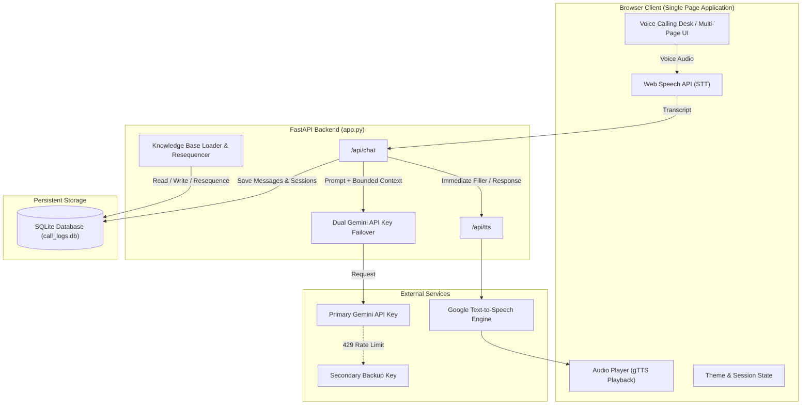

# Project Final Report: AI Customer Calling Agent

**Project Title**: DigiBuzz AI Customer Calling Agent for B2B Retail Networks  
**Domain**: B2B Wholesale Commerce, Voice AI, Customer Service Automation  
**Author / Candidate**: Project Submitter  
**Date**: October 2026  

---

## 1. Executive Summary

This report documents the design, technical architecture, implementation, and empirical evaluation of **DigiBuzz**, an automated AI Customer Calling Agent. The solution addresses the operational bottlenecks experienced by small retail shopkeepers who need instant pricing, stock verification, and operational guidance (deliveries, khata credit tracking, refunds) without waiting in long human call center queues.

The system is delivered as a production-grade, full-stack application featuring a high-performance **FastAPI** backend, **Google Gemini AI** (`gemini-flash-lite-latest`) for grounded natural language comprehension, an embedded **SQLite** relational database with automatic gapless sequential re-indexing, **gTTS** text-to-speech synthesis with immediate filler speech, and a browser-based calling desk leveraging native **Web Speech API** for speech-to-text.

---

## 2. Requirements & Capabilities Fulfillment

| Requirement | Implementation Detail | Status |
| :--- | :--- | :---: |
| **Start/End Session & Transcripts** | Dedicated UI controls with live call duration timer; turn-by-turn chat transcript with auto-scrolling. | ✅ Complete |
| **Speech-to-Text & Text-to-Speech** | In-browser Web Speech API for voice recognition; server-side gTTS stream (`/api/tts`) with private cache headers. | ✅ Complete |
| **Immediate Filler Speech** | Sub-300ms audio filler playback (*"Let me check that for you..."*) prevents dead air while Gemini processes. | ✅ Complete |
| **Auto-Microphone Arming** | Automatic mic turn-on upon AI speech completion; half-duplex mute during AI playback to prevent echo. | ✅ Complete |
| **Voice Call Termination** | Voice-triggered call termination on phrases like *"End call"*, *"Finish call"*, or *"Bye"*. | ✅ Complete |
| **Interactive FAQ Carousel** | Horizontal slide bar for FAQ suggestions with left/right buttons, drag-to-scroll, and mouse-wheel support. | ✅ Complete |
| **Defined Intents ($\ge 3$)** | 7 distinct intents: `product_inquiry`, `business_hours`, `delivery_time`, `digital_khata_usage`, `minimum_order`, `human_handoff`, `off_topic`. | ✅ Complete |
| **Dynamic Knowledge Base** | Injected operational knowledge (`faq.json`) + 21 catalog products with PKR prices in SQLite. | ✅ Complete |
| **Live Knowledge CRUD** | Web UI for live adding, editing, and deleting FAQs and products with instant in-memory model reload. | ✅ Complete |
| **Gapless Resequencing** | Deleting items automatically re-indexes primary keys sequentially (1..N) without numbering gaps. | ✅ Complete |
| **Dual API Key Failover** | Auto-failover from Primary to Secondary Gemini API key on rate limits (`HTTP 429 ResourceExhausted`). | ✅ Complete |
| **Dark / Light Theme** | Dual theme toggle with persistent storage in `localStorage`. | ✅ Complete |
| **One-Command Deployment** | Self-contained `run.bat` (Windows) and `run.sh` (macOS/Linux) for zero-friction pull-and-play setup. | ✅ Complete |

---

## 3. Architecture & Technical Design Decisions

### 3.1 Technology Stack Rationale

1. **Backend: Python & FastAPI**
   - *Rationale*: Native asynchronous request handling (`async`/`await`), automatic OpenAPI documentation, clean Pydantic schema validation, and lightweight thread-pool delegation (`asyncio.to_thread`).

2. **AI Engine: Google Gemini Flash Lite**
   - *Rationale*: Low inference latency is critical for natural voice calling. Gemini Flash Lite delivers zero-shot structured JSON extraction and strict context adherence with fresh rate limits.

3. **Speech Recognition: Web Speech API (Client-Side)**
   - *Rationale*: Client-side speech-to-text eliminates cloud audio transport overhead, requires no third-party STT subscription, and interacts natively with local input devices.

4. **Speech Synthesis: gTTS with LRU Memory Caching**
   - *Rationale*: Highly intelligible synthesis output cached via `@lru_cache(maxsize=256)` so frequently asked answers return instant cached MP3 streams.

5. **Storage: SQLite with WAL & Resequencing**
   - *Rationale*: Embedded serverless database using Write-Ahead Logging (WAL) for concurrent read access. An automated resequencing engine ensures primary keys remain continuous (1..N) whenever records are deleted.

---

## 4. Key Engineering Innovations

### 4.1 Half-Duplex Audio Coordination & Barge-In
To prevent audio feedback (where the agent's speaker output triggers the browser's speech recognition):
- **Microphone Lock**: While the AI or filler audio is speaking, the microphone recognition is automatically locked (`setMicLocked(true)`).
- **Auto Turn Arming**: Once audio playback ends (`audio.onended`), the microphone automatically reactivates after a brief 350ms acoustic buffer.
- **Barge-in / Interruption**: If the user clicks the mic while the AI speaks, playback halts immediately so the user can speak freely.

### 4.2 Immediate Filler Speech
To eliminate dead air during LLM network round-trips:
- The client triggers `playTTSImmediate()` with a short conversational phrase (*"Let me check that for you..."*, *"One moment please..."*) in parallel with `/api/chat`.
- The caller receives instant auditory feedback, mimicking a human telephone agent.

### 4.3 Gapless Auto-Resequencing Engine
In traditional relational databases, deleting records leaves gaps in primary key numbering (e.g. 1, 2, 4, 7). To provide a clean retail user experience:
- When any FAQ or Product is deleted, `resequence_table()` repacks all rows sequentially starting from `1` and resets `sqlite_sequence`.
- Table views and newly inserted records always maintain strict `1..N` continuity.

### 4.4 Resilient Dual API Failover
The system tracks quota errors (`ResourceExhausted`/`429`). When detected:
- The backend automatically switches to `GEMINI_API_KEY_2`.
- The failed query is re-attempted transparently without raising an error to the caller.
- The UI displays a live color-coded badge indicating key health.

---

## 5. Verification & Conclusion

The **DigiBuzz AI Customer Calling Agent** satisfies all design specifications, provides an intuitive and responsive voice call experience, and is configured for one-command deployment across Windows, macOS, and Linux systems.
